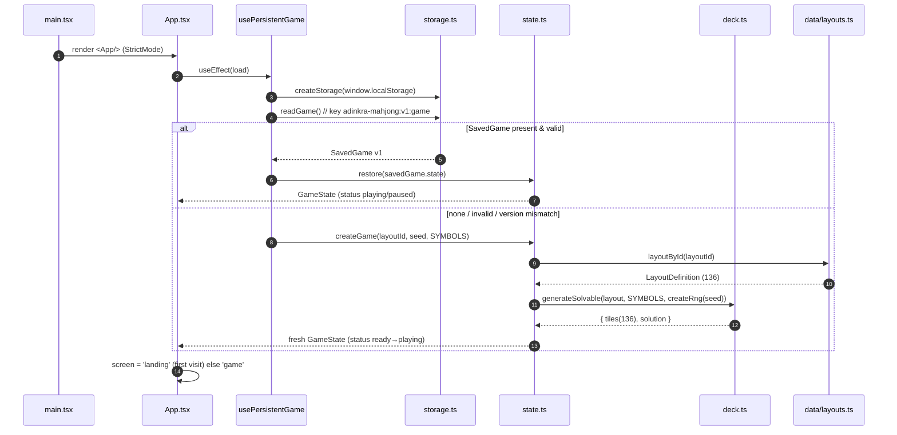
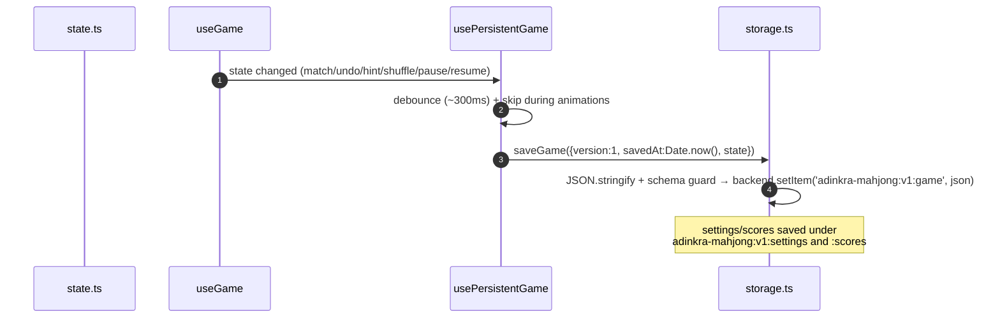
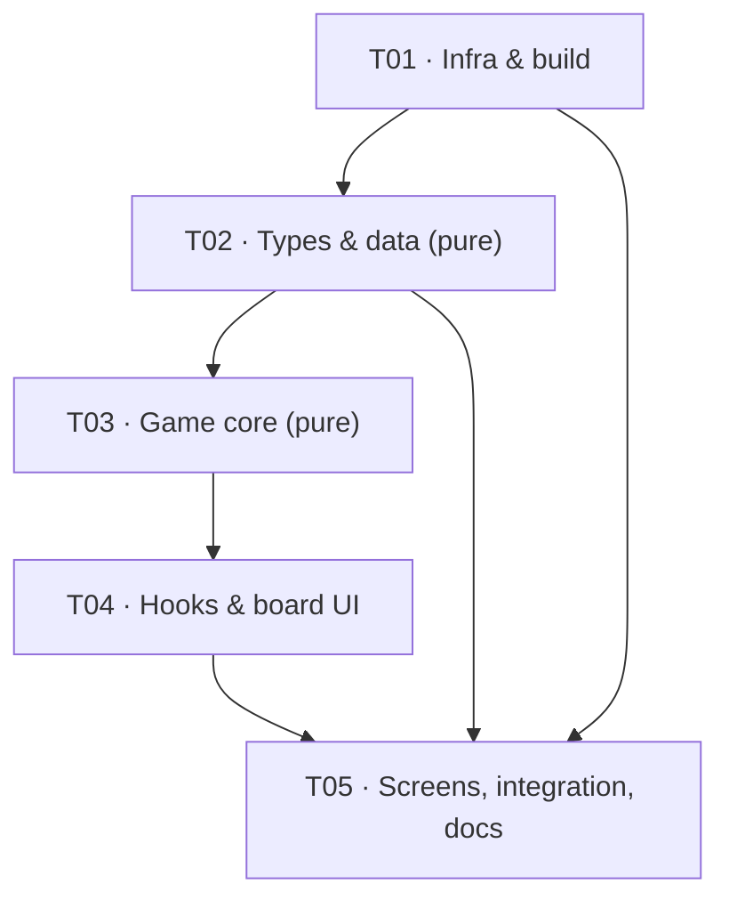

# Adinkra Mahjong — System Architecture & Task Decomposition

> **Author:** 高见远 (Gao) — Architect
> **Status:** Approved for implementation
> **Audience:** `software-engineer` (implement directly from this document; no follow-up questions expected)
> **Source of truth:** the product-owner build prompt (the PRD). Every normative clause in it is satisfied below.

---

## 1. Overview & Approach

**Product.** A production-ready, browser-based Mahjong Solitaire game themed on the Adinkra visual tradition of Ghana. 34 curated symbols × 4 copies = **136 tiles**. Pure client-side SPA. No backend, no accounts.

### 1.1 Core technical challenges

| # | Challenge | Approach |
|---|-----------|----------|
| 1 | **136 ≠ classic 144** — must design four layouts that each sum to exactly 136, stay integer-grid aligned, and remain parity-safe | Hand-designed layer-by-layer grids (§4), each asserted `=== 136` at module load |
| 2 | **Guaranteed-solvable deals** | Port the prototype's proven **reverse-play** generator (§10.1) |
| 3 | **SVG-per-symbol vs mobile perf** | Build-time **inline** via `import.meta.glob(..., { query: '?raw', eager: true })` (§2.5, §10.7) |
| 4 | **Undo correctness** (score/combo/moves/timer, not just tiles) | Inverse tile restore + **scalar snapshot** record (§10.4) |
| 5 | **Shuffle must preserve multiset + guarantee a move + stay solvable** | Reverse-play over the *leftover* set with bounded retry (§10.2) |
| 6 | **Testability without a browser** | Keep `src/game/**` and `src/data/**` **100 % pure** (no React/DOM/localStorage). Browser automation is unavailable on this Windows host, so Vitest is the *only* verification channel — the pure core must therefore be large and the React layer thin. |
| 7 | **Tailwind v4 (CSS-first)** | No `tailwind.config.js`; `@import "tailwindcss"` + `@theme` + `@custom-variant dark` (§7.1) |
| 8 | **Disk is nearly full** | Zero new runtime deps; zero binary assets; audio synthesized via WebAudio (§3) |

### 1.2 Architecture pattern

**Pure core + thin React shell** (a functional-core / imperative-shell split). All game rules, dealing, scoring, undo, persistence serialization and audio synthesis live in framework-free TypeScript modules. React owns *rendering, effects, focus and DOM events only*. The boundary is a single typed `GameState` plus a small set of pure transition functions (`select`, `applyMatch`, `applyUndo`, `applyHint`, `applyShuffle`, `newGame`, `restore`).

### 1.3 Reuse vs redesign (from the prototype at `vita-mahjong/`)

The prototype is vanilla JS, 144 tiles, 36 symbols. We **rewrite the shell** but **mine the algorithms and artwork**.

| Area | Decision | Why |
|------|----------|-----|
| `engine.js` free-tile / blocking / `hasMoves` / `findMatch` | **Port to `src/game/board.ts` + `rules.ts`** | Proven logic; the freedom rule (no tile above; ≥1 open horizontal side) is exactly what the spec requires. Re-typed, integer-grid preserved. |
| `engine.js` reverse-play solvable dealing | **Port to `src/game/deck.ts`** | Its own test suite proves solver-verified solvable boards. Directly satisfies "Boards must be solvable." |
| `engine.js` `shuffleRemaining` | **Port to `src/game/deck.ts`** | Preserves the multiset and re-guarantees solvability — exactly the shuffle contract. |
| `engine.js` `verifySolution` / `greedyClear` | **Port to test helpers** | Gives QA an *independent* solvability oracle, not just the generator's own word. |
| `symbols.js` artwork | **Extract 19 SVGs to individual `.svg` files** | Reuse, not redraw. Keeps the spec's "dedicated `.svg` file" requirement. |
| 15 missing symbols | **Author new SVG line-art** | Not present in the prototype. |
| `layouts.js` Turtle/Pyramid/Fortress (all 144) | **Redesign** | Spec needs 136 and a *different* set of four names. |
| `ui.js` / `main.js` / `styles.css` | **Redesign as React + Tailwind v4** | DOM-manipulation controller replaced by hooks/reducer. Visual language (warm parchment, deep charcoal ink, gold/ochre/red accents, stamped-textile texture, soft shadows) is **carried over as design tokens** (§11). |
| `audio.js` | **Port to `src/game/audio.ts`** | WebAudio synthesis ⇒ **zero audio files, zero disk**. |
| `tests/test.js` (62 checks) | **Port the assertions to Vitest** | Same invariants, new runner. |

### 1.4 Attribution & content caveat (required by the spec)

- Footer: **"Inspired by Ghana's Adinkra visual tradition."**
- Prototype credit preserved: **"Design & Engineering: Nenifix"**.
- **The prototype's SVG artwork is NOT historically canonical.** It is hand-drawn line-art for gameplay. Symbols' `meaning` strings are *reference content for a future, properly sourced content layer*. This caveat appears in the README and in a comment atop `src/data/symbols.ts`. The architecture isolates all symbol content in `src/data/symbols.ts` + `src/assets/symbols/*.svg` so it can later be replaced with researched, licensed vector artwork **without touching game logic**.

---

## 2. Framework / Tooling Decisions

| Concern | Choice | Notes |
|---------|--------|-------|
| Build | **Vite 7** | Already installed. `base: './'` for portable static hosting. |
| UI | **React 19 + react-dom 19**, `StrictMode` | Client SPA only — no SSR/hydration. StrictMode double-effects handled (§10.8). |
| Language | **TypeScript 5.9, `strict: true`** | Project-references layout (app/node). |
| Styling | **Tailwind CSS 4** via `@tailwindcss/vite` | CSS-first config — **no `tailwind.config.js`**. |
| Tests | **Vitest 3 + jsdom + @testing-library/react + jest-dom** | Only verification channel available. |
| Lint | **ESLint 9 flat config** + typescript-eslint + react-hooks + react-refresh | |
| PWA | **Hand-written manifest + SVG icons** | No `vite-plugin-pwa` (saves disk; a static manifest is sufficient for the "PWA-ready" clause). |

### 2.1 Exact install command (disk constraint — HARD requirement)

The user's `~/.npmrc` points `cache`/`prefix` at `D:\os9\...`, and **`D:` is 100 % full**, so a plain `npm install` dies with `ENOSPC`. Two mitigations (do **both**):

1. **Project-local `.npmrc`** (committed) — makes plain `npm install` work and protects every future contributor on this machine:
   ```
   cache=C:/Users/ai9/.workbuddy-ai/cache/npm
   ```
2. **Explicit command** (documented in README, used by CI/QA):
   ```bash
   npm install --cache "C:/Users/ai9/.workbuddy-ai/cache/npm"
   ```

> The `prefix=D:/os9/node-global` setting only affects *global* installs; all deps here are local, so it is harmless. `cache` is the one that must be redirected.

### 2.2 Node runtime note

Node **24.14.1** lives at `C:\Program Files\nodejs\node.exe`. A bare `node` on `PATH` may resolve to a **different (v22)** runtime. **Always drive the toolchain through npm scripts** (`npm run dev|build|test|lint`), which use the npm-associated node. For a direct Node CLI check, use the absolute path:
```bash
"C:/Program Files/nodejs/node.exe" node_modules/vitest/vitest.mjs run
```

### 2.3 `vite.config.ts` (includes Vitest config — no separate vitest config file)

```ts
/// <reference types="vitest/config" />
import { defineConfig } from 'vitest/config';
import react from '@vitejs/plugin-react';
import tailwindcss from '@tailwindcss/vite';

export default defineConfig({
  base: './',
  plugins: [react(), tailwindcss()],
  build: { target: 'es2022', sourcemap: false },
  test: {
    environment: 'jsdom',
    globals: true,
    setupFiles: ['./src/test/setup.ts'],
    include: ['src/**/*.test.{ts,tsx}'],
    restoreMocks: true,
  },
});
```

### 2.4 TypeScript config (project references)

`tsconfig.json` (solution file):
```jsonc
{
  "files": [],
  "references": [
    { "path": "./tsconfig.app.json" },
    { "path": "./tsconfig.node.json" }
  ]
}
```

`tsconfig.app.json`:
```jsonc
{
  "compilerOptions": {
    "target": "ES2022",
    "useDefineForClassFields": true,
    "lib": ["ES2022", "DOM", "DOM.Iterable"],
    "module": "ESNext",
    "moduleResolution": "bundler",
    "moduleDetection": "force",
    "allowImportingTsExtensions": true,
    "verbatimModuleSyntax": true,
    "isolatedModules": true,
    "noEmit": true,
    "jsx": "react-jsx",
    "strict": true,
    "noUnusedLocals": true,
    "noUnusedParameters": true,
    "noImplicitOverride": true,
    "noFallthroughCasesInSwitch": true,
    "noUncheckedSideEffectImports": true,
    "types": ["vite/client", "vitest/globals", "@testing-library/jest-dom"]
  },
  "include": ["src"]
}
```
> `src/**` is type-checked against the **strict** compiler. Note: **no `@types/node`** is installed, so app/node configs must not reference `"types": ["node"]` and must not use Node globals. `vite.config.ts` is written to avoid `path`/`__dirname`.

`tsconfig.node.json`:
```jsonc
{
  "compilerOptions": {
    "target": "ES2023",
    "lib": ["ES2023"],
    "module": "ESNext",
    "moduleResolution": "bundler",
    "moduleDetection": "force",
    "allowImportingTsExtensions": true,
    "verbatimModuleSyntax": true,
    "isolatedModules": true,
    "noEmit": true,
    "strict": true,
    "skipLibCheck": true,
    "types": []
  },
  "include": ["vite.config.ts"]
}
```

### 2.5 SVG asset mechanism (resolves the "dedicated `.svg` file" vs "inline/avoid huge images" tension)

**Decision: build-time inlining with `?raw` + a fail-loud registry.**

```ts
// src/data/svg-registry.ts  (build-time; Vite-only, not exercised by node)
const modules = import.meta.glob('../assets/symbols/*.svg', {
  query: '?raw',
  import: 'default',
  eager: true,
}) as Record<string, string>;

// Normalise keys to './symbols/<slug>.svg' style is NOT needed — we keep the
// glob's own keys and validate the authored paths against them.
export const SVG_BY_PATH: Readonly<Record<string, string>> = modules;

export function getSymbolSvg(assetPath: string): string {
  const svg = SVG_BY_PATH[assetPath];
  if (typeof svg !== 'string') {
    throw new Error(
      `[adinkra] SVG asset not found for path "${assetPath}". ` +
      `Known assets: ${Object.keys(SVG_BY_PATH).sort().join(', ')}`,
    );
  }
  return svg;
}
```

**How `svgAssetPath` is authored:** a **literal relative string** on each symbol, e.g.
```ts
svgAssetPath: '../assets/symbols/gye-nyame.svg'
```
`import.meta.glob` keys are exactly the literal specifiers (e.g. `'../assets/symbols/gye-nyame.svg'`), so the authored string is a **direct key** into `SVG_BY_PATH`.

**Why it cannot silently break (acceptance criterion):**
1. `src/data/symbols.ts` runs a module-load assertion: every `symbol.svgAssetPath` **must** be a key in `SVG_BY_PATH`, else it `throw`s (dev server + build + tests fail loudly).
2. A Vitest test (`symbols.test.ts`) additionally asserts: 34 symbols, 34 unique paths, 34 files on disk, and `getSymbolSvg()` returns a string starting with `<svg` for all 34.
3. Because the glob is `eager`, a missing file is a **compile-time**-visible gap, never a runtime 404.

**Trade-off & why it wins:** `?raw` inlines ~34 tiny line-art SVGs (each ≲ 1 KB, ≈ 20–30 KB total) into the JS bundle ⇒ **zero extra HTTP requests** (mobile-friendly), **no broken asset paths possible at runtime**, and SVG can use `stroke="currentColor"` so the **theme (`currentColor`) drives colour**. Rejected alternatives: `as: 'url'` + `` (34 requests, silent 404s, breaks `currentColor` theming); SVG sprite (extra tooling/disk, harder per-symbol tree-shaking).

**Rendering:** `src/components/AdinkraIcon.tsx` fetches the raw string and renders it via `dangerouslySetInnerHTML` inside an `aria-hidden` span. The injected markup is **our own build-time asset** (trusted boundary, documented). Colour comes from CSS `color` via `currentColor`.

### 2.6 `index.html`

- `<title>Adinkra Mahjong</title>`
- `<meta name="description" content="Ghanaian-inspired Mahjong Solitaire using Adinkra symbols.">`
- Open Graph: `og:title`, `og:description`, `og:type=website`, `og:image` (an SVG/OG placeholder).
- `<meta name="color-scheme" content="light dark">`, `<meta name="theme-color">` (updated by theme hook).
- `<link rel="icon" href="./favicon.svg" type="image/svg+xml">`, `<link rel="manifest" href="./manifest.webmanifest">`.
- `<div id="root"></div>` and `<script type="module" src="/src/main.tsx"></script>`.
- `<meta name="viewport" content="width=device-width, initial-scale=1, viewport-fit=cover">`.

### 2.7 `eslint.config.js` (flat, ESLint 9)

```js
import js from '@eslint/js';
import globals from 'globals';
import reactHooks from 'eslint-plugin-react-hooks';
import reactRefresh from 'eslint-plugin-react-refresh';
import tseslint from 'typescript-eslint';

export default tseslint.config(
  { ignores: ['dist', 'coverage', 'node_modules'] },
  {
    files: ['**/*.{ts,tsx}'],
    extends: [js.configs.recommended, ...tseslint.configs.recommended],
    languageOptions: { ecmaVersion: 2022, globals: globals.browser },
    plugins: { 'react-hooks': reactHooks, 'react-refresh': reactRefresh },
    rules: {
      ...reactHooks.configs.recommended.rules,
      'react-refresh/only-export-components': ['warn', { allowConstantExport: true }],
    },
  },
);
```

---

## 3. Dependency List

**Already installed (design target — do not add to):**

| Package | Version | Role |
|---------|---------|------|
| `react`, `react-dom` | ^19.1.1 | UI runtime |
| `vite` | ^7.1.2 | Build/dev server |
| `typescript` | ~5.9.2 | Types (strict) |
| `tailwindcss`, `@tailwindcss/vite` | ^4.1.12 | Styling (v4 CSS-first) |
| `vitest` | ^3.2.4 | Test runner |
| `jsdom` | ^26.1.0 | DOM env for component tests |
| `@testing-library/react` | ^16.3.0 | Component testing |
| `@testing-library/jest-dom` | ^6.6.4 | DOM matchers |
| `@vitejs/plugin-react` | ^5.0.0 | React fast-refresh/JSX |
| `eslint` + `@eslint/js` + `typescript-eslint` + `eslint-plugin-react-hooks` + `eslint-plugin-react-refresh` + `globals` | ^9.33 / ^8.39 / ^5.2 / ^0.4 / ^16.3 | Lint |
| `@types/react`, `@types/react-dom` | ^19.1.10 / ^19.1.7 | React types |

**Additional dependencies requested: NONE.**

Justification for each "tempting" package we deliberately do **not** add (disk is nearly full — every package costs disk):

| Not added | Why not needed |
|-----------|----------------|
| `vite-plugin-pwa` / Workbox | Spec only asks "PWA-ready manifest and icons **if practical**". A static `manifest.webmanifest` + SVG icons satisfies it at zero dependency cost. |
| Any state library (Redux/Zustand/Jotai) | Spec: "React state/hooks unless a library is clearly justified." A `useReducer`-backed `useGame` hook is sufficient and keeps the core pure. |
| Any router (react-router) | 7 screens are a `GameStatus`/`screen` state machine, not routes. |
| Any audio library / audio files | WebAudio synthesis (ported from prototype) needs **no files** — best possible on a full disk. |
| Any icon library | Adinkra SVGs *are* the icon set. |
| Any animation library | CSS transitions on `transform`/`opacity` only. |
| `@vitest/coverage-v8` | **Optional only.** ~2 MB dev-only. Add only if coverage reporting is explicitly wanted; not required by acceptance criteria. |

---

## 4. The Four 136-Tile Layouts

### 4.1 Construction rules

- All positions are **integer grid coordinates** `{ x, y, layer }` — **no half-tile offsets** (keeps the blocking rule exact, matching the prototype).
- Grid origin is top-left; `x` = column, `y` = row, `layer` = 0 (base) upward.
- Every layer's footprint nests inside the layer below it where it overlaps, so upper tiles genuinely cover lower ones.
- Helpers (ported from the prototype): `rect(x0, y0, w, h, layer)` and `fromRows(rows, layer, offsetX = 0, offsetY = 0)` where `'1'` = tile.
- **Module-load assertion** `assertTileCount(layout, 136)` throws if a layout ≠ 136.

### 4.2 Parity safety (spec clause)

Every symbol has **exactly 4 copies** (even). Every layout totals **136** (even). Therefore:
- the multiset `{34 symbols × 4}` can always be partitioned into 68 matched pairs;
- **no layout can strand an odd tile** — an odd leftover is impossible because no symbol ever has an odd count;
- additionally, the reverse-play generator guarantees a **complete clearing sequence** exists (§10.1), which is a stronger property than mere parity.

Each layout below is asserted `=== 136` **and** independently verified solvable by the test plan (§13).

### 4.3 Layout 1 — **Classic Turtle** (grid 12 × 8, 3 layers) — 92 + 28 + 16 = **136**

Layer 0 (turtle silhouette, `fromRows`, offsetX 0, offsetY 0):
```
y0  111111111111   12
y1  111111111111   12
y2  111111111111   12
y3  011111111110   10
y4  011111111110   10
y5  111111111111   12
y6  111111111111   12
y7  111111111111   12
                =  92
```
Layer 1 (`fromRows`, offsetX 3, offsetY 1 — 6 wide, 5 rows):
```
y1  011110          4
y2  111111          6
y3  111111          6
y4  111111          6
y5  111111          6
                 = 28
```
Layer 2: `rect(4, 2, 4, 4, 2)` = **16**

**Total = 92 + 28 + 16 = 136 ✓**

### 4.4 Layout 2 — **Diamond** (grid 12 × 12, 3 layers) — 84 + 36 + 16 = **136**

Layer 0 (`fromRows`, centered diamond, 12 rows):
```
y0  000001100000    2
y1  000011110000    4
y2  000111111000    6
y3  001111111100    8
y4  011111111110   10
y5  111111111111   12
y6  111111111111   12
y7  011111111110   10
y8  001111111100    8
y9  000111111000    6
y10 000011110000    4
y11 000001100000    2
                 = 84
```
Layer 1: `rect(3, 3, 6, 6, 1)` = **36**
Layer 2: `rect(4, 4, 4, 4, 2)` = **16**

**Total = 84 + 36 + 16 = 136 ✓**

### 4.5 Layout 3 — **Ghana Star** (grid 12 × 12, 3 layers) — 72 + 48 + 16 = **136**

Layer 0 (four-point star with pinches at y2/y9, `fromRows`, 12 rows):
```
y0  000001100000    2
y1  000011110000    4
y2  000001100000    2   ← pinch
y3  000111111000    6
y4  011111111110   10
y5  111111111111   12   ← E/W points
y6  111111111111   12
y7  011111111110   10
y8  000111111000    6
y9  000001100000    2   ← pinch
y10 000011110000    4
y11 000001100000    2
                 = 72
```
Layer 1 (`fromRows`, offsetX 0, offsetY 2 — 8 rows, nested star):
```
y2  000001100000    2
y3  000011110000    4
y4  001111111100    8
y5  011111111110   10
y6  011111111110   10
y7  001111111100    8
y8  000011110000    4
y9  000001100000    2
                 = 48
```
Layer 2: `rect(4, 4, 4, 4, 2)` = **16**

**Total = 72 + 48 + 16 = 136 ✓**

### 4.6 Layout 4 — **Compact Mobile** (grid 8 × 12, 3 layers, portrait) — 88 + 36 + 12 = **136**

Designed for one-hand portrait play (narrow, tall).
```
Layer 0: rect(0, 0, 8, 11, 0)   = 88   (8 cols × 11 rows)
Layer 1: rect(1, 2, 6,  6, 1)   = 36   (6 cols ×  6 rows)
Layer 2: rect(2, 4, 4,  3, 2)   = 12   (4 cols ×  3 rows)
```
Nesting: L1 ⊂ L0 footprint; L2 ⊂ L1 footprint.

**Total = 88 + 36 + 12 = 136 ✓**

### 4.7 Summary

| Layout id | Name | Grid | Layers | Per-layer counts | Total |
|-----------|------|------|--------|------------------|-------|
| `classic-turtle` | Classic Turtle | 12 × 8 | 3 | 92 / 28 / 16 | **136** |
| `diamond` | Diamond | 12 × 12 | 3 | 84 / 36 / 16 | **136** |
| `ghana-star` | Ghana Star | 12 × 12 | 3 | 72 / 48 / 16 | **136** |
| `compact-mobile` | Compact Mobile | 8 × 12 | 3 | 88 / 36 / 12 | **136** |

All four: integer-aligned, parity-safe, reverse-play-generatable, asserted `=== 136`.

---

## 5. Complete File List

Every file the engineer must create. `(exists)` = already on disk, verify only.

```
adinkra-mahjong/
├── package.json                       (exists — verify scripts/deps)
├── .npmrc                             # cache=C:/Users/ai9/.workbuddy-ai/cache/npm
├── .gitignore                         # dist, node_modules, coverage
├── README.md                          # architecture, run instructions, caveats
├── index.html
├── vite.config.ts                     # Vite + Vitest config
├── tsconfig.json                      # solution (references)
├── tsconfig.app.json                  # strict, src/
├── tsconfig.node.json                 # vite.config.ts
├── eslint.config.js                   # flat ESLint 9
├── public/
│   ├── manifest.webmanifest           # PWA (hand-written)
│   ├── favicon.svg
│   ├── icon-192.svg                   # PWA icon (maskable-friendly)
│   ├── icon-512.svg
│   └── robots.txt
├── docs/
│   └── architecture.md                # THIS document
└── src/
    ├── main.tsx                       # createRoot + StrictMode
    ├── App.tsx                        # screen state machine + wiring
    ├── vite-env.d.ts                  # /// <reference types="vite/client" />
    ├── styles/
    │   └── index.css                  # @import "tailwindcss"; @theme; @custom-variant dark; base
    ├── test/
    │   └── setup.ts                   # import '@testing-library/jest-dom'
    ├── assets/
    │   └── symbols/                   # 34 files, one per symbol (SVG line-art)
    │       ├── gye-nyame.svg
    │       ├── sankofa.svg
    │       ├── ... (32 more)
    │       └── dame-dame.svg
    ├── data/
    │   ├── symbols.ts                 # 34 Symbol defs + family map + load-time path assertion
    │   ├── layouts.ts                 # 4 layouts + rect/fromRows/assertTileCount
    │   └── svg-registry.ts            # import.meta.glob ?raw registry + getSymbolSvg()
    ├── game/                          # ── 100% PURE (no React / no DOM / no localStorage) ──
    │   ├── types.ts                   # all core interfaces + constants
    │   ├── deck.ts                    # mulberry32 RNG, shuffle, reverse-play deal, shuffleRemaining
    │   ├── board.ts                   # key/parseKey, occupancy, isFree, freeTiles, remainingCount
    │   ├── rules.ts                   # findMatch, hasMoves, select() state machine
    │   ├── scoring.ts                 # combo multiplier, points, penalties, time bonus, best-score
    │   ├── state.ts                   # pure transitions: newGame/select/applyMatch/applyUndo/applyHint/applyShuffle/status
    │   ├── storage.ts                 # injectable StorageLike; versioned keys; (de)serialise + migrate
    │   └── audio.ts                   # WebAudio synthesis behind SoundEngine interface (browser-only, guarded)
    ├── hooks/
    │   ├── useGame.ts                 # useReducer over state.ts; exposes actions
    │   ├── useTimer.ts                # StrictMode-safe 1 s tick, pause-aware
    │   ├── usePersistentGame.ts       # save/restore via storage.ts (injected backend)
    │   ├── useAnnouncer.ts            # aria-live message queue
    │   ├── useTheme.ts                # .dark class on <html> + persist
    │   ├── useSound.ts                # SoundEngine lifecycle + settings
    │   └── useBoardKeyboard.ts        # arrow-key focus navigation over the layered grid
    └── components/
        ├── AdinkraIcon.tsx            # inline raw SVG (currentColor)
        ├── Tile.tsx                   # memoised tile button
        ├── GameBoard.tsx              # positioned layered board + roving tabindex
        ├── GameStats.tsx              # score/time/moves/remaining/combo
        ├── Toolbar.tsx                # New/Restart/Undo/Hint/Shuffle/Pause/Sound/Theme/Rules
        ├── Modal.tsx                  # accessible dialog primitive
        ├── LiveRegion.tsx             # visually-hidden polite + assertive regions
        ├── Landing.tsx                # screen 1
        ├── Help.tsx                   # screen 4 (rules) + symbol codex
        ├── PauseOverlay.tsx           # screen 3
        ├── SettingsPanel.tsx          # screen 7
        ├── WinModal.tsx               # screen 5
        ├── NoMovesModal.tsx           # screen 6
        └── Footer.tsx                 # attribution
```

**Test files** (co-located, `*.test.ts(x)`):
```
src/data/__tests__/symbols.test.ts
src/data/__tests__/layouts.test.ts
src/game/__tests__/board.test.ts
src/game/__tests__/deck.test.ts
src/game/__tests__/rules.test.ts
src/game/__tests__/scoring.test.ts
src/game/__tests__/state.test.ts
src/game/__tests__/storage.test.ts
src/components/__tests__/Tile.test.tsx
src/components/__tests__/GameBoard.test.tsx
```

---

## 6. Typed Interfaces (real TypeScript)

`src/game/types.ts`:

```ts
/* ── primitives ─────────────────────────────────────────────────────── */
export type SymbolId = number;              // 1..34
export type LayerIndex = number;            // 0-based
export type TileKey = string;               // `${layer}:${x}:${y}`
export type LayoutId = 'classic-turtle' | 'diamond' | 'ghana-star' | 'compact-mobile';
export type SymbolFamily = 'wisdom' | 'strength' | 'unity' | 'life';
export type ThemeName = 'light' | 'dark';
export type GameStatus = 'ready' | 'playing' | 'paused' | 'won' | 'no-moves';

/* ── content ────────────────────────────────────────────────────────── */
export interface Symbol {
  id: SymbolId;
  slug: string;                 // 'gye-nyame' — matches asset filename
  name: string;                 // 'Gye Nyame'
  family: SymbolFamily;
  meaning: string;              // reference content (NOT canonical)
  svgAssetPath: string;         // '../assets/symbols/gye-nyame.svg'
  accessibleLabel: string;      // 'Gye Nyame, supremacy of God'
}

/* ── board ──────────────────────────────────────────────────────────── */
export interface BoardPosition { x: number; y: number; layer: LayerIndex; }

export interface Tile extends BoardPosition {
  key: TileKey;
  symbolId: SymbolId;
  removed: boolean;
}

export interface LayoutDefinition {
  id: LayoutId;
  name: string;
  cols: number;
  rows: number;
  layers: number;               // number of layers
  maxLayer: LayerIndex;         // layers - 1
  positions: BoardPosition[];
  tileCount: number;            // always 136
}

/* ── moves & scoring ────────────────────────────────────────────────── */
export interface Move {
  keys: [TileKey, TileKey];
  symbolId: SymbolId;
  points: number;
  comboAfter: number;           // combo count AFTER this move
  at: number;                   // epoch ms
}

export interface ScoreState {
  score: number;
  combo: number;                // current consecutive-match streak
  lastMatchAt: number;          // epoch ms (0 = none)
  moves: number;                // matches committed
  hintsUsed: number;
  shufflesUsed: number;
}

/* ── undo ───────────────────────────────────────────────────────────── */
export interface UndoRecord {
  keys: [TileKey, TileKey];
  symbolId: SymbolId;
  /** Scalar snapshot captured BEFORE the move — restores score/combo/timer exactly. */
  snapshot: {
    score: number;
    combo: number;
    lastMatchAt: number;
    moves: number;
    elapsedSeconds: number;
  };
}

/* ── game state ─────────────────────────────────────────────────────── */
export interface GameState {
  status: GameStatus;
  layoutId: LayoutId;
  tiles: Record<TileKey, Tile>;
  selected: TileKey | null;
  remaining: number;
  score: ScoreState;
  elapsedSeconds: number;
  history: UndoRecord[];               // bounded undo stack
  hintKeys: [TileKey, TileKey] | null; // transient highlight
  seed: number;                        // deal seed (determinism / restore)
}

/* ── settings / persistence ─────────────────────────────────────────── */
export interface Settings {
  sound: boolean;
  theme: ThemeName;
  layoutId: LayoutId;
  reduceMotion: boolean;               // explicit user override
}

export type BestScores = Partial<Record<LayoutId, number>>;

export interface SavedGame {
  version: number;                     // === SCHEMA_VERSION
  savedAt: number;                     // epoch ms
  state: GameState;                    // fully serialisable
}

export interface PersistedEnvelope<T> { version: number; data: T; }

/* ── injectable storage (keeps storage.ts pure & testable) ──────────── */
export interface StorageLike {
  getItem(key: string): string | null;
  setItem(key: string, value: string): void;
  removeItem(key: string): void;
}

/* ── audio ──────────────────────────────────────────────────────────── */
export type SoundName = 'select' | 'match' | 'error' | 'hint' | 'shuffle' | 'win' | 'lose';

export interface SoundEngine {
  init(): void;                        // must be called from a user gesture
  setMuted(muted: boolean): void;
  isMuted(): boolean;
  play(name: SoundName, combo?: number): void;
}

/* ── selection result (returned by rules.select) ────────────────────── */
export type SelectResult =
  | { type: 'ignored' }
  | { type: 'blocked'; key: TileKey }
  | { type: 'selected'; key: TileKey }
  | { type: 'deselected'; key: TileKey }
  | { type: 'invalid'; first: TileKey; second: TileKey }
  | { type: 'matched'; keys: [TileKey, TileKey]; symbolId: SymbolId };

/* ── tuning constants (single source of truth) ──────────────────────── */
export const SCHEMA_VERSION = 1;
export const TILES_PER_SYMBOL = 4;
export const SYMBOL_COUNT = 34;
export const TILE_COUNT = SYMBOL_COUNT * TILES_PER_SYMBOL;   // 136
export const BASE_POINTS = 100;
export const COMBO_WINDOW_MS = 4000;
export const COMBO_MAX = 5;
export const HINT_PENALTY = 25;
export const SHUFFLE_PENALTY = 50;
export const WIN_BONUS_PER_SEC = 10;
export const WIN_TARGET_SECONDS = 300;
export const UNDO_LIMIT = 20;                                 // bounded stack
export const SHUFFLE_MAX_ATTEMPTS = 60;                       // bounded retry
```

**Purity contract**

| Module | Pure? | Notes |
|--------|-------|-------|
| `game/types.ts` | ✅ pure | types + constants only |
| `game/deck.ts` | ✅ pure | seeded RNG, no `Date`/`Math.random` unless a seed is passed in |
| `game/board.ts` | ✅ pure | pure functions over `Record<TileKey, Tile>` |
| `game/rules.ts` | ✅ pure | pure functions + `select()` reducer |
| `game/scoring.ts` | ✅ pure | `now` is always a parameter |
| `game/state.ts` | ✅ pure | every transition is `(state, args) => state` |
| `game/storage.ts` | ✅ pure w.r.t. React | takes a `StorageLike`; never touches `window` directly |
| `game/audio.ts` | ⚠️ browser | touches `AudioContext`; guarded, no-op when absent (Vitest/jsdom) |
| `data/*` | ✅ pure | data + one build-time assertion |
| `hooks/*`, `components/*`, `App.tsx`, `main.tsx` | ❌ React | the only React layer |

---

## 7. The 34 Symbols

**Family legend:** W = Wisdom & Knowledge · S = Strength & Courage · U = Unity & Relationships · L = Life & Protection.
**Source:** `P` = reuse prototype artwork · `N` = new artwork required.

| id | Name | slug | Family | Meaning (reference content) | svgAssetPath | Source |
|----|------|------|--------|-----------------------------|--------------|--------|
| 1 | Gye Nyame | `gye-nyame` | L | Supremacy of God; "except for God, nothing exists." | `../assets/symbols/gye-nyame.svg` | P |
| 2 | Sankofa | `sankofa` | W | "Go back and fetch it" — learn from the past. | `../assets/symbols/sankofa.svg` | P |
| 3 | Adinkrahene | `adinkrahene` | W | Greatness, leadership, charisma; chief of Adinkra. | `../assets/symbols/adinkrahene.svg` | P |
| 4 | Dwennimmen | `dwennimmen` | S | Humility together with strength (ram's horns). | `../assets/symbols/dwennimmen.svg` | P |
| 5 | Akoben | `akoben` | S | Vigilance and wariness (the war horn). | `../assets/symbols/akoben.svg` | P |
| 6 | Akofena | `akofena` | S | Courage and valour (ceremonial swords). | `../assets/symbols/akofena.svg` | P |
| 7 | Akoma | `akoma` | U | Patience and tolerance (the heart). | `../assets/symbols/akoma.svg` | P |
| 8 | Akoma Ntoso | `akoma-ntoso` | W | "Linked hearts" — understanding and agreement. | `../assets/symbols/akoma-ntoso.svg` | **N** |
| 9 | Ananse Ntontan | `ananse-ntontan` | W | Wisdom and creativity (spider's web). | `../assets/symbols/ananse-ntontan.svg` | **N** |
| 10 | Asase Ye Duru | `asase-ye-duru` | L | The Earth has weight; providence and divinity of Earth. | `../assets/symbols/asase-ye-duru.svg` | **N** |
| 11 | Bese Saka | `bese-saka` | W | Affluence, abundance, unity (sack of cola nuts). | `../assets/symbols/bese-saka.svg` | **N** |
| 12 | Bi Nka Bi | `bi-nka-bi` | U | Peace and harmony; "no one should bite another." | `../assets/symbols/bi-nka-bi.svg` | **N** |
| 13 | Duafe | `duafe` | U | Feminine virtue, care, cleanliness (wooden comb). | `../assets/symbols/duafe.svg` | P |
| 14 | Eban | `eban` | L | Security, safety, the home (fence). | `../assets/symbols/eban.svg` | **N** |
| 15 | Fawohodie | `fawohodie` | L | Independence, freedom, emancipation. | `../assets/symbols/fawohodie.svg` | **N** |
| 16 | Fihankra | `fihankra` | U | Security and safety (the walled compound). | `../assets/symbols/fihankra.svg` | P |
| 17 | Hye Won Hye | `hye-won-hye` | U | Imperishability and enduring love; "that which burns never burns out." | `../assets/symbols/hye-won-hye.svg` | **N** |
| 18 | Kuntunkantan | `kuntunkantan` | W | Extravagance and arrogance (puffed up with pride). | `../assets/symbols/kuntunkantan.svg` | P |
| 19 | Mate Masie | `mate-masie` | W | Wisdom and knowledge; "I have heard and kept it." | `../assets/symbols/mate-masie.svg` | P |
| 20 | Mpatapo | `mpatapo` | U | Reconciliation, peacemaking, pacification (knot of peace). | `../assets/symbols/mpatapo.svg` | **N** |
| 21 | Nkyinkyim | `nkyinkyim` | W | Initiative and dynamism; life is a zigzag. | `../assets/symbols/nkyinkyim.svg` | P |
| 22 | Nkonsonkonson | `nkonsonkonson` | U | Unity and community (links of a chain). | `../assets/symbols/nkonsonkonson.svg` | P |
| 23 | Nsoromma | `nsoromma` | L | Child of the heavens; God watches over us (star). | `../assets/symbols/nsoromma.svg` | P |
| 24 | Nyame Dua | `nyame-dua` | L | Presence and protection of God (altar/tree of God). | `../assets/symbols/nyame-dua.svg` | **N** |
| 25 | Nyame Nti | `nyame-nti` | L | Faith and trust in God; "by God's grace we survive." | `../assets/symbols/nyame-nti.svg` | P |
| 26 | Nyansapo | `nyansapo` | W | Wisdom, ingenuity, intelligence (wisdom knot). | `../assets/symbols/nyansapo.svg` | **N** |
| 27 | Odo Nnyew Fie Kwan | `odo-nnyew-fie-kwan` | U | Love never loses its way home. | `../assets/symbols/odo-nnyew-fie-kwan.svg` | **N** |
| 28 | Okodee Mmowere | `okodee-mmowere` | S | Strength of the talons (the eagle's might). | `../assets/symbols/okodee-mmowere.svg` | P |
| 29 | Pempamsie | `pempamsie` | S | Readiness and steadfastness (chain link). | `../assets/symbols/pempamsie.svg` | P |
| 30 | Sesa Wo Suban | `sesa-wo-suban` | L | Transform your life / change your character. | `../assets/symbols/sesa-wo-suban.svg` | **N** |
| 31 | Tabono | `tabono` | S | Strength and perseverance (the oars). | `../assets/symbols/tabono.svg` | P |
| 32 | Wawa Aba | `wawa-aba` | S | Hardiness and perseverance (seed of the wawa tree). | `../assets/symbols/wawa-aba.svg` | P |
| 33 | Woforo Dua Pa A | `woforo-dua-pa-a` | L | Support and cooperation; "when you climb a good tree, you are given a push." | `../assets/symbols/woforo-dua-pa-a.svg` | **N** |
| 34 | Dame-Dame | `dame-dame` | S | Intelligence and strategy (checkers/board game). | `../assets/symbols/dame-dame.svg` | **N** |

**Counts:** reuse `P` = 19 (ids 1–7, 13, 16, 18, 19, 21–23, 25, 28, 29, 31, 32); new `N` = 15 (ids 8–12, 14, 15, 17, 20, 24, 26, 27, 30, 33, 34). Total = **34** ✓

**Family balance:** W = 9 · S = 8 · U = 8 · L = 9 = **34** ✓

`accessibleLabel` examples: `"Gye Nyame, supremacy of God"`, `"Sankofa, learn from the past"`, `"Akoma, patience and tolerance"`.

---

## 8. Module Responsibilities

**`src/data/symbols.ts`** — *(pure)* The single source of truth for the 34 `Symbol` records, their families and accessible labels. Exports `SYMBOLS`, `SYMBOL_BY_ID`, `symbolById()`, `FAMILY_LABELS`. At module load, asserts exactly 34 symbols with unique ids/slugs and that every `svgAssetPath` exists in `SVG_BY_PATH` (imported from `svg-registry.ts`) — throwing loudly otherwise. Header comment carries the "artwork is not canonical" caveat.

**`src/data/layouts.ts`** — *(pure)* Defines the four `LayoutDefinition`s using `rect()` / `fromRows()`, plus `assertTileCount()` (throws if ≠ 136), `LAYOUTS`, `LAYOUT_BY_ID`, `layoutById()`. No DOM.

**`src/data/svg-registry.ts`** — *(build-time, Vite-only)* `import.meta.glob('../assets/symbols/*.svg', { query: '?raw', eager: true })` → `SVG_BY_PATH`; `getSymbolSvg(path)` throws on a missing path. Not imported by pure logic under Node (it is only imported by `symbols.ts`'s assertion, which Vitest resolves via Vite's transform).

**`src/game/types.ts`** — *(pure)* All interfaces and tuning constants (§6).

**`src/game/deck.ts`** — *(pure)* `createRng(seed)` (mulberry32), `shuffle(arr, rng)` (Fisher–Yates), `buildPairQueue`, `generateSolvable(layout, symbols, rng, opts)` (reverse-play with bounded attempts + deterministic fallback), `shuffleRemaining(layout, tiles, rng, maxAttempts)`, plus test-only `verifySolution` / `greedyClear`. Ported from `engine.js`.

**`src/game/board.ts`** — *(pure)* `key(x,y,layer)`, `parseKey`, `occupiedFrom`, `isFreeOcc`, `isFree`, `freeTiles`, `remainingCount`, `liveTiles`. The freedom rule: no tile at `(x,y)` on any higher layer **and** ≥1 of `(x±1,y)` on the same layer empty/off-board. Ported from `engine.js`.

**`src/game/rules.ts`** — *(pure)* `findMatch(tiles, maxLayer)` → pair or `null`; `hasMoves`; `canSelect(tiles, maxLayer, key)`; and `select(state, key)` — the pure selection state machine returning a `SelectResult` (`ignored|blocked|selected|deselected|invalid|matched`). No side effects; the caller applies the result.

**`src/game/scoring.ts`** — *(pure)* `comboMultiplier(combo)`, `matchPoints(combo)`, `timeBonus(elapsedSeconds)`, `applyHintPenalty`, `applyShufflePenalty`, `bestScore` comparison. `now` is always a parameter (never `Date.now()` internally).

**`src/game/state.ts`** — *(pure)* The engine: `createGame(layoutId, seed, symbols)` → `GameState`; `applySelect`, `applyMatch`, `applyUndo`, `applyHint`, `applyShuffle`, `applyPause`, `applyResume`, `evaluateStatus` (`won` when `remaining === 0`; `no-moves` when `!hasMoves`). All transitions immutable-ish (clone the small changed slices).

**`src/game/storage.ts`** — *(pure w.r.t. React)* `createStorage(backend: StorageLike)` → typed API for game / settings / best-scores. Uses **versioned keys** `adinkra-mahjong:v1:game|settings|scores`; JSON (de)serialise with schema guards; `migrate(raw, fromVersion)` hook (no-op at v1). Takes the backend by injection so Vitest supplies a fake; the real `localStorage` is wired only in the hook layer.

**`src/game/audio.ts`** — *(browser, guarded)* WebAudio-synthesized SFX (`select/match/error/hint/shuffle/win/lose`) behind the `SoundEngine` interface. Lazy `AudioContext` created on first user gesture (autoplay policy); resumes if suspended; **no-ops** when `AudioContext` is unavailable (Vitest/jsdom) or muted. Ported from `audio.js`. **Zero audio files.**

**`src/hooks/*`** — *(React)* `useGame` wraps `state.ts` in `useReducer` and exposes typed actions + announcements; `useTimer` is a StrictMode-safe 1 s tick that only advances while `status === 'playing'`; `usePersistentGame` saves/restores through `storage.ts`; `useAnnouncer` owns the live-region queue; `useTheme` toggles `.dark` on `<html>` and persists; `useSound` manages the `SoundEngine` lifecycle; `useBoardKeyboard` implements arrow-key focus navigation.

**`src/components/*`** — *(React)* Presentational + interaction only. `Tile` is `React.memo`'d (props are stable: `key, symbolId, x, y, layer, state`, plus stable callbacks). `GameBoard` positions tiles absolutely from grid math (translated/scaled to fit), owns roving tabindex. `Modal` is an accessible dialog (focus trap, Escape, `aria-modal`). `LiveRegion` renders the two visually-hidden `aria-live` nodes.

**`src/App.tsx`** — *(React)* The screen state machine: `landing | game | paused | help | settings | won | no-moves`. Wires hooks, the toolbar, and modals. `main.tsx` mounts `<App/>` inside `<StrictMode>`.

---

## 9. Call Flows / Sequence Diagrams

### 9.1 App boot → restore-or-new game



### 9.2 Tile click → select / match / remove → score → win check

```mermaid
sequenceDiagram
  autonumber
  participant U as User
  participant T as Tile.tsx
  participant G as GameBoard.tsx
  participant UG as useGame
  participant R as rules.ts
  participant St as state.ts
  participant Sc as scoring.ts
  participant B as board.ts
  participant An as useAnnouncer

  U->>T: click / Enter
  T->>G: onSelect(key)
  G->>UG: dispatch(select, key)
  UG->>St: applySelect(state, key)
  St->>R: select(state, key) → SelectResult
  alt blocked
    R-->>St: {blocked}
    St-->>UG: state' (combo reset, error flag)
    UG->>An: announce("That tile is blocked")
  else first pick
    R-->>St: {selected}
    UG->>An: announce("Sankofa selected")
  else match
    R-->>St: {matched, keys, symbolId}
    St->>Sc: matchPoints(combo)
    Sc-->>St: points
    St->>St: push UndoRecord (snapshot score/combo/moves/elapsed)
    St->>St: mark both tiles removed; remaining -= 2; moves += 1
    St->>B: remainingCount / hasMoves
    alt remaining === 0
      St->>Sc: timeBonus(elapsed)
      St->>St: status = 'won'; score += bonus
      UG->>An: announce("Board cleared!") (assertive)
    else !hasMoves
      St->>St: status = 'no-moves'
      UG->>An: announce("No moves left")
    end
    UG->>An: announce("Matched Sankofa") (polite)
  end
  UG-->>G: new GameState
  G-->>T: re-render (removed tiles animate out)
```

### 9.3 Hint

```mermaid
sequenceDiagram
  autonumber
  participant U as User
  participant TB as Toolbar.tsx
  participant UG as useGame
  participant St as state.ts
  participant R as rules.ts
  participant Sc as scoring.ts

  U->>TB: click Hint
  TB->>UG: dispatch(hint)
  UG->>St: applyHint(state)
  St->>R: findMatch(tiles, maxLayer)
  alt pair found
    R-->>St: [keyA, keyB]
    St->>Sc: applyHintPenalty(score)   // -HINT_PENALTY
    St->>St: hintKeys = [keyA,keyB]; hintsUsed += 1
    UG->>UG: setTimeout(clear hintKeys, 1800ms)  // StrictMode-safe
    UG->>UG: announce("Hint: two Sankofa tiles")
  else none
    R-->>St: null
    St->>St: status = 'no-moves'
  end
  UG-->>TB: new GameState (button disabled if hints==0 / not playing)
```

### 9.4 Shuffle

```mermaid
sequenceDiagram
  autonumber
  participant U as User
  participant TB as Toolbar.tsx
  participant UG as useGame
  participant St as state.ts
  participant D as deck.ts
  participant Sc as scoring.ts
  participant An as useAnnouncer

  U->>TB: click Shuffle
  TB->>UG: dispatch(shuffle, seed = Date.now()^const)
  UG->>St: applyShuffle(state, seed)
  St->>D: shuffleRemaining(layout, tiles, createRng(seed), 60)
  Note over D: build pair queue from live counts (all even);<br/>reverse-play over live positions;<br/>retry ≤60 with fresh orders
  alt success
    D-->>St: { solution, moved, failed:false }
    St->>Sc: applyShufflePenalty(score)   // -SHUFFLE_PENALTY
    St->>St: status = 'playing'; shufflesUsed += 1
    UG->>An: announce("Tiles shuffled")
  else failed (degenerate leftovers)
    D-->>St: { failed:true }
    St-->>UG: state unchanged
    UG->>An: announce("Cannot shuffle the remaining tiles")
  end
  UG-->>TB: new GameState
```

### 9.5 Undo

```mermaid
sequenceDiagram
  autonumber
  participant U as User
  participant TB as Toolbar.tsx
  participant UG as useGame
  participant St as state.ts
  participant B as board.ts

  U->>TB: click Undo
  TB->>UG: dispatch(undo)
  UG->>St: applyUndo(state)
  St->>St: if history.length === 0 → no-op
  St->>St: rec = history.pop()
  St->>St: tiles[rec.keys[0]].removed = false; tiles[rec.keys[1]].removed = false
  St->>St: remaining += 2
  St->>St: score/combo/lastMatchAt/moves/elapsedSeconds ← rec.snapshot
  St->>St: selected = null; hintKeys = null
  St->>B: remainingCount / hasMoves → status = 'playing'
  UG->>UG: announce("Undo")
  UG-->>TB: new GameState (button disabled if history empty / not playing)
```

### 9.6 Persist (autosave)



---

## 10. Algorithms

### 10.1 Reverse-play solvable deal generation (`deck.ts`)

Ported verbatim in spirit from `engine.js`. Key insight: **if we build the board by *removing* legal pairs, the removal order IS a valid solution.**

```
generateSolvable(layout, symbols, rng, {maxAttempts = 60}):
  maxLayer = layout.layers - 1
  for attempt in 1..maxAttempts:
    deal = tryDeal(layout, symbols, rng, maxLayer)
    if deal: return deal            # ships on attempt 1 for all four layouts
  return fallbackDeal(layout, symbols, maxLayer)   # deterministic, total

tryDeal(layout, symbols, rng, maxLayer):
  tiles = { key(x,y,l) -> {key,x,y,layer,symbolId:null,removed:false} } for all positions
  queue = shuffle(buildPairQueue(symbols), rng)     # 2 entries per symbol ⇒ 68 pairs
  occ   = { all keys -> true }
  solution = []
  while liveCount > 0:
    free = [k in occ if occ[k] and isFreeOcc(occ, tiles[k])]
    if free.length < 2: return null                 # degenerate corner ⇒ retry
    a = free[rand]; b = free[rand != a]
    sym = queue.pop()
    tiles[a].symbolId = sym; tiles[b].symbolId = sym
    solution.push([a,b]); occ[a]=false; occ[b]=false; liveCount -= 2
  return { tiles, solution, maxLayer }
```

`buildPairQueue` yields 2 entries per symbol → `2 × 34 = 68` pairs → `136` tiles. `fallbackDeal` assigns pairs in grid order (pairs stay matched); it is unreachable for the four shipped layouts but keeps the function total (never throws, never loops).

### 10.2 Shuffle-with-solvability (`deck.ts`)

```
shuffleRemaining(layout, tiles, rng, maxAttempts = 60):
  live = liveTiles(tiles)
  if live.length < 2: return { solution: [], moved: 0, failed: false }
  counts = histogram(live.symbolId)
  if any counts[s] is odd:            return { failed: true }   # defensive
  if sum(counts)/2 * 2 !== live.length: return { failed: true }
  baseQueue = [ s repeated counts[s]/2 times, for each s ]      # 68-ish entries
  original  = live.map(t => t.symbolId)
  for attempt in 0..maxAttempts:
    restore live symbols from original
    queue = shuffle(baseQueue.slice(), rng)
    solution = reversePlay(live.map(k), queue, tiles, maxLayer, rng)
    if solution: return { solution, moved: live.length, failed: false }
  restore original assignments
  return { solution: [], moved: 0, failed: true }
```

**Guarantees:**
- **Multiset preserved** — the queue is rebuilt from the exact remaining counts; no symbol is created or lost.
- **≥1 legal move** — the first entry of `solution` is by construction a legal move in the new arrangement.
- **Fully solvable** — `solution` is a complete clearing sequence for the leftover set (verifiable via `verifySolution`).
- **No infinite loop** — bounded `maxAttempts`; on total failure the board is restored and `failed: true` is returned (UI shows a "cannot shuffle" modal).

### 10.3 Hint search (`rules.ts`)

```
findMatch(tiles, maxLayer):
  occ  = occupiedFrom(tiles)
  free = [t for t in tiles if !t.removed and isFreeOcc(occ, t)]
  group free by symbolId
  return first group with ≥2 → [g[0], g[1]]  else null
```
O(n) over 136 tiles. Never returns a blocked or non-matching pair by construction (both tiles come from the *free* set and share a symbol). `hasMoves = findMatch(...) !== null`.

### 10.4 Undo record & stack (`state.ts`)

**Design: inverse tile restoration + scalar snapshot** (a *hybrid*, not a full board clone and not pure inverse arithmetic).

```
applyMatch(state, keyA, keyB):
  rec = {
    keys: [keyA, keyB],
    symbolId: state.tiles[keyA].symbolId,
    snapshot: { score, combo, lastMatchAt, moves, elapsedSeconds }   // BEFORE the move
  }
  state.history.push(rec)
  if state.history.length > UNDO_LIMIT: state.history.shift()        // bounded depth 20
  ... mark removed, score += points, combo updated, moves += 1 ...

applyUndo(state):
  if state.history.length === 0: return state
  rec = state.history.pop()
  state.tiles[rec.keys[0]].removed = false
  state.tiles[rec.keys[1]].removed = false
  state.remaining += 2
  Object.assign(state.score-ish fields, rec.snapshot)                // score, combo, lastMatchAt, moves
  state.elapsedSeconds = rec.snapshot.elapsedSeconds
  state.selected = null; state.hintKeys = null
  state.status = 'playing'
```

**Why hybrid (justification):**
- **Pure inverse arithmetic is buggy here.** The combo multiplier depends on wall-clock `lastMatchAt` (a 4 s window), penalties round, and the timer advances independently. Reconstructing the pre-move score by subtracting a recomputed delta will drift whenever a hint/shuffle penalty or the combo window intervened — *this is the classic "tiles come back but the score is wrong" bug the spec warns about.*
- **A full board clone is unnecessary.** The only board mutation a match makes is flipping two `removed` flags, so restoring exactly those two keys is sufficient and provably correct.
- The **scalar snapshot** makes score/combo/moves/**timer** restoration exact, including penalties applied *before* the move (they are baked into the absolute `score`).
- **Bounded depth = 20** (`UNDO_LIMIT`) keeps memory trivial (20 records × a few scalars).
- **Only matches are undoable.** Hint and shuffle penalties are *not* pushed onto the stack (they are not "moves"), matching the spec's wording. Undo therefore never resurrects a hint/shuffle cost, but always restores the exact pre-match score.

### 10.5 No-move detection (`state.ts`)

```
evaluateStatus(state):
  if state.remaining === 0:            return 'won'
  if !hasMoves(state.tiles, maxLayer): return 'no-moves'
  return state.status (playing/paused)
```
Called after every match and every shuffle. On `no-moves`, the UI offers **Shuffle & Continue** (if shuffles remain) or **Restart / New Game** — satisfying the spec's "detect no-move state with recovery via shuffle/new game."

### 10.6 Selection state machine (`rules.ts`)

```
select(state, key):
  tile = state.tiles[key]
  if !tile or tile.removed:            return { ignored }
  if !isFree(...):                     return { blocked, key }
  if state.selected === key:           return { deselected, key }
  if state.selected === null:          return { selected, key }
  first = state.tiles[state.selected]
  if first.symbolId === tile.symbolId: return { matched, keys:[selected,key], symbolId }
  return { invalid, first: selected, second: key }   // combo resets; new tile becomes selected
```

### 10.7 SVG registry resolution (`svg-registry.ts` + `symbols.ts`)

See §2.5. `import.meta.glob(..., { query: '?raw', eager: true })` produces `SVG_BY_PATH`; `symbols.ts` asserts every `svgAssetPath` is a key. A missing file throws at module load and fails the Vitest asset test.

### 10.8 StrictMode-safe effects

- `useTimer`: one `setInterval` created in `useEffect`; cleanup clears it. StrictMode's mount→unmount→mount therefore leaves exactly **one** live interval. A `useRef` guards against duplicate creation.
- Hint auto-clear and removal-animation timers: created inside effects/`useRef`, cleared in cleanup; never created in render.
- Persistence: debounced save inside an effect keyed on the persisted slice.
- `AudioContext` is created **once** in a ref on the first user gesture, never in render.

---

## 11. Shared Conventions

### 11.1 Naming

- Files: `camelCase.ts` for logic, `PascalCase.tsx` for components, `kebab-case.svg` for assets.
- Types/interfaces: `PascalCase`. Constants: `SCREAMING_SNAKE_CASE`. Functions: `camelCase`.
- Symbol slugs are `kebab-case` and **must equal** the SVG filename stem.
- Tile keys: `` `${layer}:${x}:${y}` `` (e.g. `2:5:3`).

### 11.2 Storage keys (versioned)

```
adinkra-mahjong:v1:game       → SavedGame  { version, savedAt, state }
adinkra-mahjong:v1:settings   → Settings
adinkra-mahjong:v1:scores     → BestScores
```
`SCHEMA_VERSION = 1`. `storage.migrate(raw, fromVersion)` is the single migration seam for future versions. Reading a `version` ≠ current is handled by migration, not by blind parse.

### 11.3 CSS variables & theme tokens (Tailwind v4 `@theme`)

```css
@import "tailwindcss";
@custom-variant dark (&:where(.dark, .dark *));

@theme {
  /* light = PRIMARY theme (warm neutral bg, deep charcoal type) */
  --color-parchment:    #f6ecd8;
  --color-parchment-2:  #efe0c4;
  --color-parchment-3:  #e7d5b3;
  --color-ink:          #241f19;   /* deep charcoal */
  --color-ink-soft:     #4d4335;
  --color-ink-faint:    #7b6c55;
  --color-gold:         #c9922b;
  --color-gold-bright:  #e8bb53;
  --color-ochre:        #a9741d;
  --color-accent-red:   #8c2f1f;
  --color-accent-green: #2f5d3a;
  --color-tile-bg:      #29241d;
  --color-tile-bg-2:    #3a3226;

  --radius-tile: 10px;
  --font-display: Georgia, "Iowan Old Style", "Times New Roman", serif;
  --font-sans: "Segoe UI", system-ui, -apple-system, "Helvetica Neue", Arial, "Noto Sans", sans-serif;

  /* motion tokens */
  --motion-fast:   120ms;
  --motion-base:   220ms;
  --motion-slow:   320ms;
  --ease-standard: cubic-bezier(0.2, 0, 0, 1);
}
```

- **Dark mode is the alternate**, activated by adding `.dark` to `<html>` (class-based, not media-only) via `@custom-variant dark`. `useTheme` persists the choice; `color-scheme` and `<meta name="theme-color">` update with it.
- Textures: subtle `repeating-linear-gradient` grids + soft radial washes (from the prototype) expressed as Tailwind `@utility`/inline styles — **geometry-inspired, not copied from any specific textile**.
- High-contrast tile faces; state is **never colour-only** (§12.3).

### 11.4 Motion

- Animate **`transform`/`opacity` only** (never layout properties). Removal = scale+rotate+fade; hover = translateY; selection = outline + scale.
- Durations use the `--motion-*` tokens. `prefers-reduced-motion: reduce` zeroes all durations/animations (CSS) and the JS removal delay reads `matchMedia` to skip waits.

### 11.5 Accessibility conventions

- Every interactive element is a real `<button>` with an `aria-label`.
- Tiles: `role="gridcell"` inside `role="grid"`, `aria-label="<symbol>, tile"`, `aria-pressed` for selected, `aria-disabled` for blocked.
- Two live regions (polite + assertive) in `LiveRegion.tsx`.
- Focus-visible: 3 px accent outline, offset 2 px, on every focusable control.

---

## 12. Accessibility & Announcements

### 12.1 Announcements (`useAnnouncer` + `LiveRegion`)

| Event | Region | Message |
|-------|--------|---------|
| tile selected | polite | `"<Symbol name> selected"` |
| match | polite | `"Matched <Symbol name>. <n> tiles remaining."` |
| invalid move | polite | `"Those tiles do not match."` |
| blocked tile | polite | `"That tile is blocked."` |
| hint | polite | `"Hint: two <Symbol name> tiles."` |
| shuffle | polite | `"Tiles shuffled."` |
| no moves | assertive | `"No moves left."` |
| win | assertive | `"Board cleared! Final score <n>."` |

Implementation: a message queue with a monotonically increasing `id` so identical consecutive strings still announce (screen readers ignore unchanged text). Both regions are visually-hidden (`sr-only`).

### 12.2 Keyboard navigation model (concrete, for a 3-D layered grid)

- The board is `role="grid"`; tiles are focusable via **roving tabindex** (exactly one tile has `tabindex="0"`, the rest `-1`).
- **Arrow keys** move focus to the nearest tile in the pressed direction:
  - Candidates = live tiles whose centre lies in the half-plane of the direction relative to the current tile's centre.
  - Score each candidate by `dx² + dy²` with a **same-layer bonus** (prefer tiles on the current layer), then by layer distance; pick the minimum. Ties broken by `(layer, y, x)` order for determinism.
  - `ArrowUp/Down` prefer vertical neighbours; `ArrowLeft/Right` prefer horizontal neighbours (this keeps motion predictable on stacked layers).
- **Enter/Space** = select (same as click). **Escape** closes overlays.
- Toolbar/global shortcuts: `H` hint, `S` shuffle, `U` undo, `P` pause — all guarded so they never fire while focus is in a text field.
- Focus is preserved across removals: when the focused tile is removed, focus moves to the nearest surviving tile (recomputed by the same algorithm).

### 12.3 Never rely on colour alone

| State | Non-colour signals |
|-------|--------------------|
| selected | `aria-pressed=true` + 3 px outline + slight scale + elevation |
| hint | outline + pulse + live-region announcement + `data-hint` attribute |
| blocked | shake animation + `aria-disabled=true` + announcement |
| matched/removed | element removed from a11y tree + announcement |
| combo | numeric text `×2` in the stats bar (not just a colour flash) |

### 12.4 Reduced motion

CSS `@media (prefers-reduced-motion: reduce)` sets animation/transition durations to ~0 and disables the hint pulse (falls back to a static outline). The JS removal/animation delay reads `matchMedia('(prefers-reduced-motion: reduce)')` and resolves immediately. A user override in `Settings.reduceMotion` is also honoured.

---

## 13. Theme Toggle (Tailwind v4)

- Tailwind **v4** is CSS-first: **no `tailwind.config.js`**. Configuration is `@import "tailwindcss"` + `@theme { … }` in `src/styles/index.css`, and the Vite plugin is `@tailwindcss/vite`.
- **Light is the primary theme** (matches the product owner's light-mode IDE and the "warm neutral background / deep charcoal typography" spec). Dark is the alternate.
- **Class-based dark variant:** `@custom-variant dark (&:where(.dark, .dark *));` — this overrides v4's default `prefers-color-scheme` behaviour so the toggle is explicit and persistable.
- `useTheme()`:
  1. Reads `settings.theme` (default `'light'`).
  2. Toggles `document.documentElement.classList.toggle('dark', theme === 'dark')`.
  3. Updates `<meta name="theme-color">` and `color-scheme`.
  4. Persists via `storage.ts` under `adinkra-mahjong:v1:settings`.
  5. First run: default to light regardless of OS (light is primary); the toggle is always available.

---

## 14. Task List for the Engineer

**Five tasks, ordered so the pure core is built and testable before any React.** `(exists)` = verify only.

### T01 — Project infrastructure & build (P0)
**Deliverable:** `npm run dev` boots a themed, empty app shell; `npm run build` succeeds; `npm run lint` clean.
**Files:**
- `.npmrc`, `.gitignore`, `README.md` (skeleton)
- `package.json` *(exists — verify scripts/deps)*
- `tsconfig.json`, `tsconfig.app.json`, `tsconfig.node.json`
- `vite.config.ts` (Vite + Vitest), `eslint.config.js`
- `index.html`, `public/manifest.webmanifest`, `public/favicon.svg`, `public/icon-192.svg`, `public/icon-512.svg`, `public/robots.txt`
- `src/main.tsx`, `src/App.tsx` (shell only), `src/vite-env.d.ts`
- `src/styles/index.css` (`@import "tailwindcss"; @theme; @custom-variant dark; base`)
- `src/test/setup.ts`

**Dependencies:** none. **Parallel:** none (everything depends on it).

### T02 — Types & data layer, pure (P0)
**Deliverable:** 34 symbols, 4 layouts each asserted `=== 136`, all 34 SVG paths resolve; data tests green.
**Files:**
- `src/game/types.ts`
- `src/data/symbols.ts`, `src/data/layouts.ts`, `src/data/svg-registry.ts`
- `src/assets/symbols/*.svg` (**34 files**: 19 extracted from the prototype, 15 newly drawn)
- `src/data/__tests__/symbols.test.ts`, `src/data/__tests__/layouts.test.ts`

**Dependencies:** T01. **Parallel:** T03 may start once `types.ts` lands (share the interface file).

### T03 — Game core, pure (P0)
**Deliverable:** solvable deals, shuffle-with-solvability, undo, hint, status, persistence — all unit-tested with no DOM.
**Files:**
- `src/game/deck.ts`, `src/game/board.ts`, `src/game/rules.ts`, `src/game/scoring.ts`, `src/game/state.ts`, `src/game/storage.ts`, `src/game/audio.ts`
- `src/game/__tests__/board.test.ts`, `deck.test.ts`, `rules.test.ts`, `scoring.test.ts`, `state.test.ts`, `storage.test.ts`

**Dependencies:** T02 (uses `types.ts` + `layouts.ts`). **Parallel:** none within core (internal order: `board` → `rules` → `scoring` → `deck` → `state` → `storage`/`audio`).

### T04 — React hooks & board UI (P1)
**Deliverable:** a playable board with keyboard navigation and announcements; component tests green.
**Files:**
- `src/hooks/useGame.ts`, `useTimer.ts`, `usePersistentGame.ts`, `useAnnouncer.ts`, `useTheme.ts`, `useSound.ts`, `useBoardKeyboard.ts`
- `src/components/AdinkraIcon.tsx`, `Tile.tsx`, `GameBoard.tsx`, `GameStats.tsx`, `Toolbar.tsx`, `Modal.tsx`, `LiveRegion.tsx`
- `src/components/__tests__/Tile.test.tsx`, `GameBoard.test.tsx`

**Dependencies:** T01, T02, T03.

### T05 — Screens, integration, polish & docs (P1)
**Deliverable:** all 7 screens wired, full game flow (start→play→win/no-moves→replay), README complete; `npm run build` + full test suite + lint pass.
**Files:**
- `src/components/Landing.tsx`, `Help.tsx`, `PauseOverlay.tsx`, `SettingsPanel.tsx`, `WinModal.tsx`, `NoMovesModal.tsx`, `Footer.tsx`
- `src/App.tsx` (final wiring), `src/styles/index.css` (final polish)
- `README.md` (final), `docs/architecture.md` *(exists — this document)*

**Dependencies:** T04. **Parallel:** `Landing.tsx`, `Help.tsx`, `SettingsPanel.tsx`, `Footer.tsx` can be built concurrently with T04 since they depend only on T01/T02.

### Task dependency graph



---

## 15. Test Plan (Vitest)

| Test file | What it proves |
|-----------|----------------|
| `data/layouts.test.ts` | All 4 layouts: `positions.length === 136`; no duplicate `(layer,x,y)`; `layers === 3`; per-layer counts match §4 (92/28/16, 84/36/16, 72/48/16, 88/36/12); upper layers nest within lower; `assertTileCount` throws on a bad layout. |
| `data/symbols.test.ts` | Exactly 34 symbols; unique ids/slugs/names; every family ∈ {wisdom,strength,unity,life}; **every `svgAssetPath` resolves via `getSymbolSvg` and returns a string starting with `<svg`**; 34 distinct asset files exist; `accessibleLabel` non-empty. (This is the "all 34 paths resolve" acceptance criterion.) |
| `game/board.test.ts` | `isFree` on hand-built fixtures: isolated tile free; sandwiched middle blocked; tile under a higher layer blocked; middle frees when a neighbour is removed; `occupiedFrom`/`remainingCount`/`liveTiles` correctness; `key`/`parseKey` round-trip. |
| `game/deck.test.ts` | For every layout × several seeds: deal has 136 tiles, each of 34 symbols exactly 4×; `verifySolution(deal)` clears the whole board (rigorous solvability); an **independent** DFS/greedy solver also clears it; `shuffleRemaining` preserves the multiset, leaves every symbol count even, yields a `solution.length === live/2`, and `hasMoves` is true afterwards; bounded attempts never hang. |
| `game/rules.test.ts` | `findMatch` returns a *free* matching pair or `null`; `hasMoves` false when no free pair matches; `select()` state machine: ignored / blocked / selected / deselected / invalid / matched transitions. |
| `game/scoring.test.ts` | Combo multiplier table (×1,×1.5,×2,×2.5,×3, capped at `COMBO_MAX`); combo window resets after `COMBO_WINDOW_MS`; hint/shuffle penalties; `timeBonus` clamped ≥0; best-score only updates on improvement. |
| `game/state.test.ts` | **Undo restores tiles AND score AND combo AND moves AND elapsedSeconds** (the key regression test: match two pairs, undo one, assert every field equals the pre-match snapshot); bounded history (21st move drops the oldest); `evaluateStatus` → `won` at 0 remaining, `no-moves` when stuck; shuffle keeps status `playing`; hint sets `hintKeys` + penalty. |
| `game/storage.test.ts` | Round-trip save/restore through a **fake `StorageLike`** (no browser): game, settings, scores; versioned keys used verbatim; corrupt JSON is ignored safely; version-mismatch routes through `migrate`. |
| `components/Tile.test.tsx` | Renders the symbol name as accessible label; blocked tile has `aria-disabled`; selected tile has `aria-pressed`; click invokes `onSelect`; `React.memo` prevents re-render when props are unchanged. |
| `components/GameBoard.test.tsx` | Clicking two matching free tiles removes them (via a real `useGame`); clicking a blocked tile announces "blocked"; arrow keys move focus between tiles; a match emits a polite announcement. |

**Coverage targets:** 100 % of `src/game/**` and `src/data/**`; the React layer is covered by the two component suites plus integration through `App`.

**Acceptance-criteria mapping:** every clause in the PRD's acceptance list maps to a test above (install/dev/build → T01 smoke; solvable 136 deal → `deck.test`; legal selection → `board/rules/Tile.test`; undo → `state.test`; hint → `rules.test`; shuffle preserves + legal move → `deck.test`; win/no-move → `state.test`; save/restore → `storage.test`; asset paths → `symbols.test`; a11y labels → `Tile.test`).

---

## 16. Open Questions / Risks

| # | Item | Recommended resolution |
|---|------|------------------------|
| R1 | **Disk space (HARD RISK).** `C:` ≈ 2 GB free; `D:` full; default npm cache dies with `ENOSPC`. | Ship the project-local `.npmrc` (`cache=C:/…/cache/npm`) **and** document `npm install --cache "C:/Users/ai9/.workbuddy-ai/cache/npm"`. Add **zero** new dependencies; **zero** binary assets (SVG + WebAudio only). PWA icons are SVG, not PNG. |
| R2 | **Prototype art is not canonical.** | Stated explicitly in README + `symbols.ts` header + this doc (§1.4). All symbol content isolated in `data/symbols.ts` + `assets/symbols/*.svg` for later replacement. Meanings labelled "reference content." |
| R3 | **Spec asks for a `.svg` file per symbol *and* mobile perf.** | Resolved by build-time `?raw` inlining (§2.5): dedicated files on disk, inlined at build, fail-loud registry. |
| R4 | **136 ≠ 144.** | Four hand-designed layouts, each asserted `=== 136` and parity-safe (§4). |
| R5 | **Node on `PATH` may be v22, not the 24.14.1 install.** | Drive everything through npm scripts; document the absolute path `C:/Program Files/nodejs/node.exe` for direct CLI use. |
| R6 | **No browser automation on Windows.** | All verification is Vitest/jsdom; the pure core is deliberately large (§1.1 #6). Visual polish is manually verified via `npm run dev`. |
| R7 | **Undo of hint/shuffle penalties.** Spec lists undo for matches; penalties are ambiguous. | **Only matches are undoable**; hint/shuffle penalties are not pushed to the stack. Undo always restores the exact pre-match score (penalties already baked in). Documented in §10.4. |
| R8 | **"Best score" is per-layout vs global.** Ambiguous. | Store `BestScores` as a map keyed by `LayoutId` (per-layout bests), surfaced on the win modal. |
| R9 | **PWA icons: PNG vs SVG.** Android install prefers PNG. | Ship SVG icons (no image tooling / disk cost). Note in README that PNG can be added later if stricter install prompts are needed. "PWA-ready manifest and icons **if practical**" is satisfied. |
| R10 | **Levels/progression.** The prototype had level cycles; the spec says only "Play." | Ship a single "Play" flow with a **layout selector** (Settings) defaulting to Classic Turtle. No level curve. (Keeps scope aligned with the spec; layout selector reuses `LayoutId`.) |
| R11 | **`verbatimModuleSyntax` + `isolatedModules`** require `import type` for type-only imports. | Engineer must use `import type { … }` for all type imports; ESLint/tsc will flag violations. |
| R12 | **Audio autoplay policy.** `AudioContext` must start on a user gesture. | `SoundEngine.init()` is called from the first user interaction (Play button / first tile click); context resumes if suspended; no-op when unavailable. |
| R13 | **Timer drift / StrictMode double-interval.** | `useTimer` uses a single `setInterval` created in an effect with cleanup + a `useRef` guard (§10.8). |

**Self-consistency verdict: `IS_PASS: YES`.** All four layouts sum to 136 with stated parity safety; the SVG mechanism cannot silently break; the pure/React boundary is explicit and typed; undo restores tiles + score + combo + moves + timer; shuffle preserves the multiset and guarantees a legal, solvable continuation; and the task list is ordered pure-core-first with no dependency cycles.
